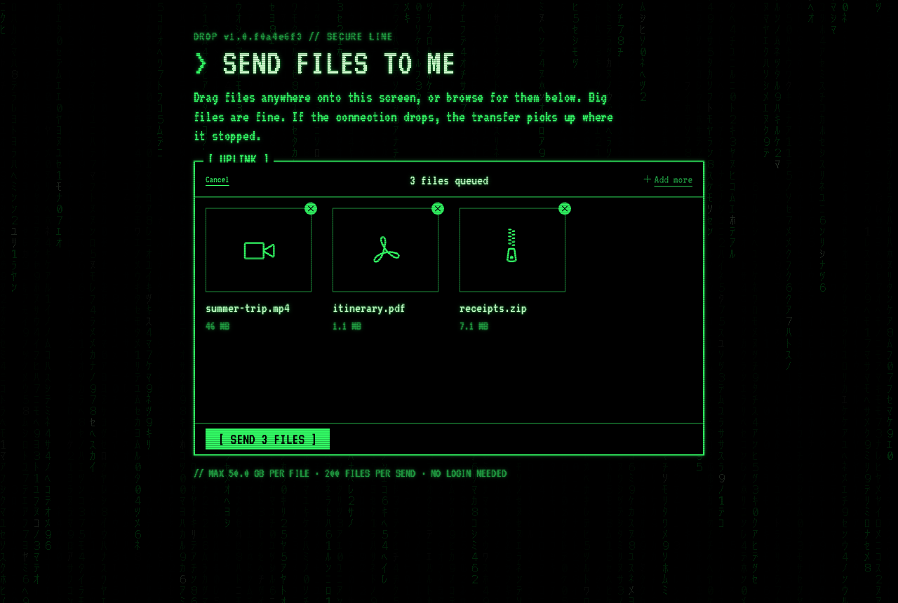
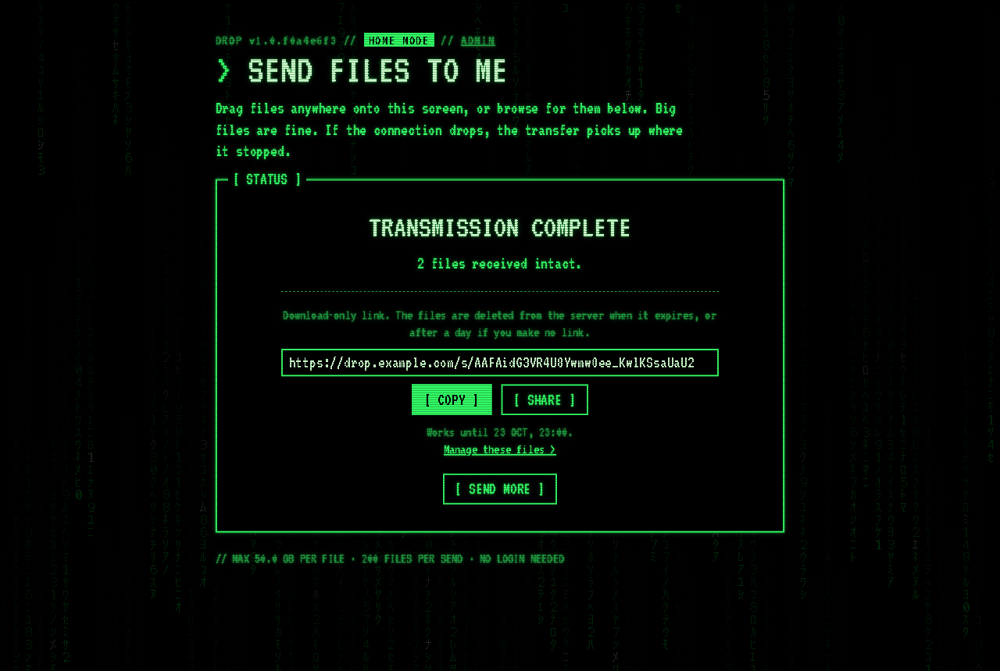
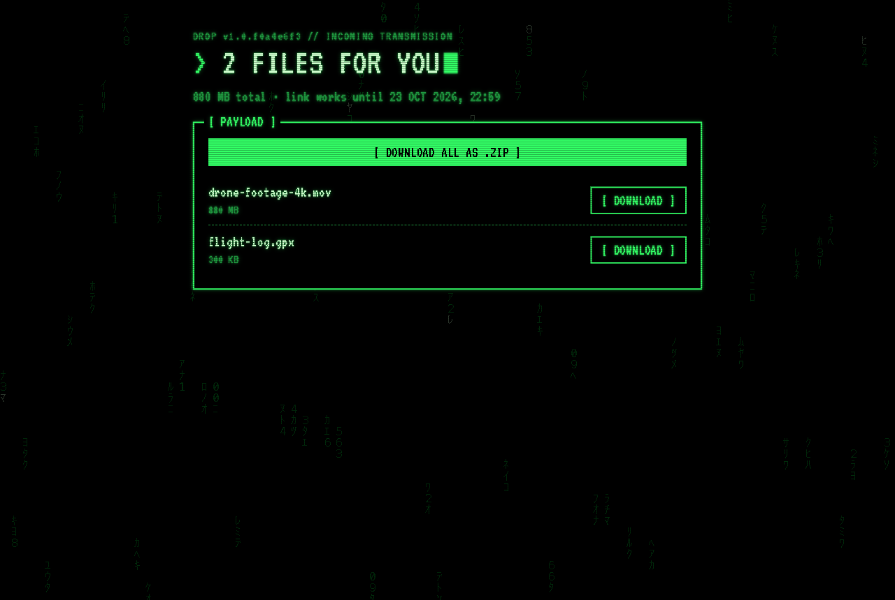
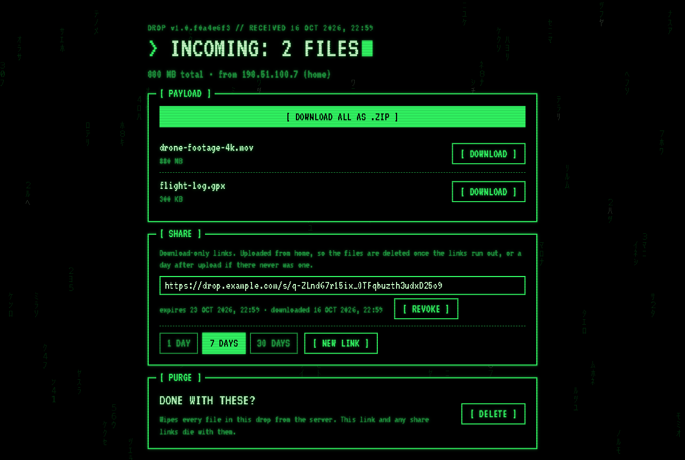
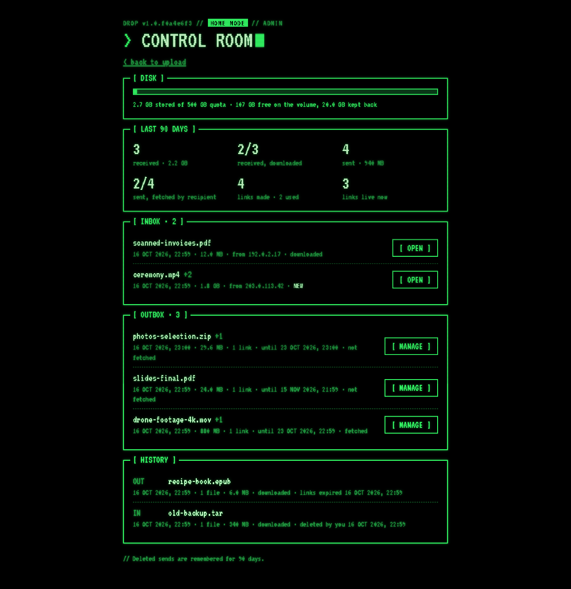

# drop

A public "send me files" page. Anyone can drag files onto it; nobody but the
owner can get them back out.

- Drag-and-drop upload ([Uppy](https://uppy.io)) over [tus](https://tus.io): 50 MB
  chunks, automatic retries, resume after a dropped connection or a reloaded tab.
- The uploader gets nothing back: no list, no links, no delete.
- When a send finishes, the owner gets an email with a link to a private page for
  that send: download each file or all of them as a .zip, then delete them from the
  server.
- The link is the only credential (a random 192-bit token). There is no login.
- The owner can also make **share links**: download-only, no delete, no sender
  details, expiring after 1, 7 or 30 days, revocable from the owner page.

## Screenshots

The data below is made up: names, links and addresses are examples.

**The upload page**, as anyone sees it, with three files queued:



**Home mode, after an upload:** one box with the result and a share link ready to
copy or send.



**What the recipient gets:** the files and nothing else.



**The owner page:** downloads, share links with their state, and delete.



**The admin page** (home mode only): disk use, 90-day statistics, inbox, outbox
and history.



## Home mode

A visitor coming from the server's own public address is taken to be the owner at
home (or on a VPN that exits there). For them the banner reads `HOME MODE`, and when
an upload finishes the page offers a share link right away, with Copy and the
system share sheet, so sending something to someone needs no email round trip.
Home-mode uploads send no email; the finish screen links to their owner page
instead. Their files are deleted once their share links run out (links revoked by
hand don't count; with all of them revoked, the files stay), or a day after upload
if no link was ever made.

Expiry needs no extra machinery: a share link is checked against its expiry on
every request, so it stops working on the second. The files go on the app's own
5-minute cleanup pass, the same one that sends late emails and removes abandoned
partial uploads.

The server learns its public address by asking `HOME_LOOKUP_URL` (default
`https://1.1.1.1/cdn-cgi/trace`, which answers with an `ip=` line) and compares it
with Cloudflare's `CF-Connecting-IP`. There is no background polling: a matching
visitor costs nothing, and a mismatch triggers a fresh lookup at most once per
`HOME_RECHECK_SECONDS` (60), so a changed home address is picked up on its own.
A failed lookup keeps the last known address; with none known, nobody is home.
Set `HOME_LOOKUP_URL=` (empty) to turn home mode off.

Home mode also links to `/admin`: disk use against the quota, 90-day statistics
(sends received and downloaded, sends shared and fetched by their recipients, links
made and used), uploads in flight, the inbox (sends to you, with their owner pages),
the outbox (your shares, their links and whether they were fetched), and the
history of deleted sends with why they went. Anyone behind the home address can
open it; from anywhere else `/admin` is a plain 404.

## Guards

Because the page is open to anyone, the app protects the disk it writes to:

| Setting | Default | Meaning |
|---|---|---|
| `MAX_FILE_SIZE` | `50G` | Largest single file |
| `MAX_TOTAL` | `500G` | Everything stored, including uploads in progress |
| `MIN_FREE` | `300G` | Refuse any upload that would leave less than this free on the volume |

Space is reserved at the moment an upload is *created*, from its declared length,
so several concurrent uploads cannot jointly overrun the limits. When an upload is
refused for space, the owner is emailed (at most twice a day).

`DATA_DIR` must contain a `.drop-volume` marker file. If the volume is not mounted,
the marker is missing, so the app refuses uploads and `/healthz` returns 503,
rather than filling the disk underneath the mount point. `REQUIRE_MARKER=0` turns
the check off.

Also: 30 new sends and 500 new files per hour per client IP (`CF-Connecting-IP`,
or the first `X-Forwarded-For` address when that header is missing), at most 200
files per send (`MAX_FILES_PER_BATCH`), and at most 20 share links per send.
Partial uploads that are not resumed within 7 days (`STALE_UPLOAD_DAYS`) are
removed.

## Notifications

The email goes out through an [Apprise API](https://github.com/caronc/apprise-api)
server: `APPRISE_URL` is its `/notify/<key>` endpoint, and `APPRISE_TAG` selects the
target (default `email`). Without `APPRISE_URL`, notifications are only logged.

A send is announced when the uploader's page reports it finished. If the page never
does (the tab was closed), it is announced after 30 quiet minutes
(`IDLE_NOTIFY_MINUTES`). If more files arrive later, another email follows.

## Sender location

Next to the sender's address, the owner page, the admin page and the email show
where it is, for example `86.59.163.158 (Budapest, Hungary)`. The location comes
from Cloudflare's headers on the request that starts the send, and is stored with
it. Nothing is looked up afterwards, and no address goes to a third party.
`CF-IPCountry` is on by default. For city and region, turn on the managed transform
**Add visitor location headers** (Rules → Settings in the zone). Without it only
the country shows. Sends from before this feature show the address alone.

## Configuration

All settings are environment variables.

| Variable | Default | Meaning |
|---|---|---|
| `PUBLIC_URL` | none | Base URL for the links in emails and for share links; without it they are relative |
| `DATA_DIR` | `/data` | Where uploads and batches live |
| `PORT` | `3000` | Port the server listens on |
| `TZ` | unset (UTC in the image, the host's zone otherwise) | Time zone for the dates on the pages |
| `APPRISE_URL` | none | Apprise API endpoint; without it, notifications are only logged |
| `APPRISE_TAG` | `email` | Apprise tag that selects the target |
| `MAX_FILE_SIZE` | `50G` | See Guards |
| `MAX_TOTAL` | `500G` | See Guards |
| `MIN_FREE` | `300G` | See Guards |
| `MAX_FILES_PER_BATCH` | `200` | Most files in one send |
| `IDLE_NOTIFY_MINUTES` | `30` | Quiet minutes before an unfinished send is announced |
| `STALE_UPLOAD_DAYS` | `7` | Days before an unresumed partial upload is removed |
| `HOME_LOOKUP_URL` | `https://1.1.1.1/cdn-cgi/trace` | Where home mode looks up the public address; empty turns home mode off |
| `HOME_RECHECK_SECONDS` | `60` | Shortest wait between lookups after a mismatch |
| `REQUIRE_MARKER` | on | The `.drop-volume` marker is required unless this is `0` |

The compose files pass only some of these to the container. `compose.yaml` passes
`TZ`, `PUBLIC_URL`, `APPRISE_URL`, `APPRISE_TAG`, `MAX_FILE_SIZE`, `MAX_TOTAL` and
`MIN_FREE`. The standalone example passes the same, with `APPRISE_URL` and
`APPRISE_TAG` fixed. `compose.yaml` fixes `TZ` to `Europe/Budapest` instead of reading it
from the environment; the standalone example reads `${TZ:-UTC}`. To set any other variable, add it under the service's
`environment:`.

## Running

```bash
npm ci
mkdir -p data && touch data/.drop-volume
DATA_DIR=./data PUBLIC_URL=http://localhost:3000 npm start
```

Tests:

```bash
npm test
```

## Deploying

drop must be reached **only through Cloudflare**. Home mode and the per-IP limits
both read the `CF-Connecting-IP` header; exposed any other way, anyone could set it.
Two ways to run it:

### On its own: `examples/standalone/`

drop, a [Cloudflare Tunnel](https://developers.cloudflare.com/cloudflare-one/connections/connect-networks/)
and an [Apprise API](https://github.com/caronc/apprise-api) server for the emails,
with nothing published on the host. This is an untested starting point:

```bash
cd examples/standalone
cp .env.example .env                                  # PUBLIC_URL, TUNNEL_TOKEN, limits
cp apprise/apprise.yml.example apprise/apprise.yml    # where the emails go
docker compose up -d --build
```

Outside the compose file, in the Cloudflare dashboard: give the tunnel a public
hostname matching `PUBLIC_URL`, with service `http://drop:3000`. Data lives in the
`drop-data` volume; a one-shot `drop-init` container hands it to uid 1000 and adds
the `.drop-volume` marker.

### Behind an existing reverse proxy: `compose.yaml`

The top-level `compose.yaml` is the one in production. It joins the proxy's Docker
network (`DROP_NETWORK`) and stores data at an absolute host path (`DROP_DATA_DIR`).
The proxy must pass `CF-Connecting-IP` through, allow request bodies over 50 MB,
and stream rather than buffer. For nginx:

```nginx
server {
    listen 80;
    server_name drop.example.com;

    client_max_body_size 60M;              # tus sends 50 MB chunks

    resolver 127.0.0.11 valid=10s ipv6=off;  # Docker DNS: follow a recreated container
    set $drop http://drop:3000;

    location / {
        proxy_pass $drop;
        proxy_set_header Host              $host;
        proxy_set_header X-Forwarded-Proto https;
        proxy_set_header CF-Connecting-IP  $http_cf_connecting_ip;
        proxy_http_version 1.1;
        proxy_request_buffering off;       # uploads resume from the last byte that arrived
        proxy_buffering off;               # big downloads and zips stream
        proxy_read_timeout 3600s;
        proxy_send_timeout 3600s;
    }
}
```

### Optional: a Cloudflare rate limit

The app limits sends and files per IP per hour. A Cloudflare rate-limiting rule
stops bursts before they reach it: count only the requests that *create* something,
not the chunk uploads or downloads. For example, 20 requests per 10 seconds per IP,
blocking for 10 seconds:

```
(http.host eq "drop.example.com" and http.request.method eq "POST"
 and http.request.uri.path in {"/files" "/files/" "/api/batches"})
```

Uppy treats the resulting 429 as a rate limit and backs off, so a big send slows
down rather than fails.

## Storage layout

```
DATA_DIR/
  .drop-volume          marker; required
  uploads/<id>          file contents (tus FileStore)
  uploads/<id>.json     tus metadata: size, filename, batch
  batches/<batch>.json  one per send: owner token, file list, share links, notification state;
                        deleted sends stay 90 days for the admin history
```

## License

[MIT](LICENSE): free for anyone to use, modify and redistribute, as long as the
copyright notice stays with every copy.
